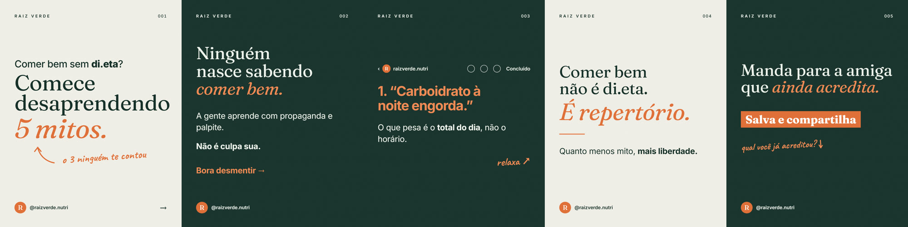
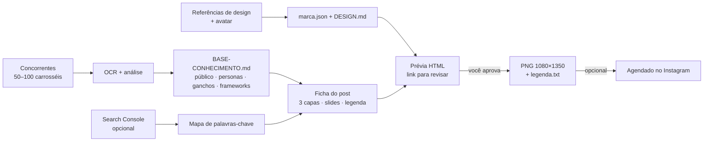
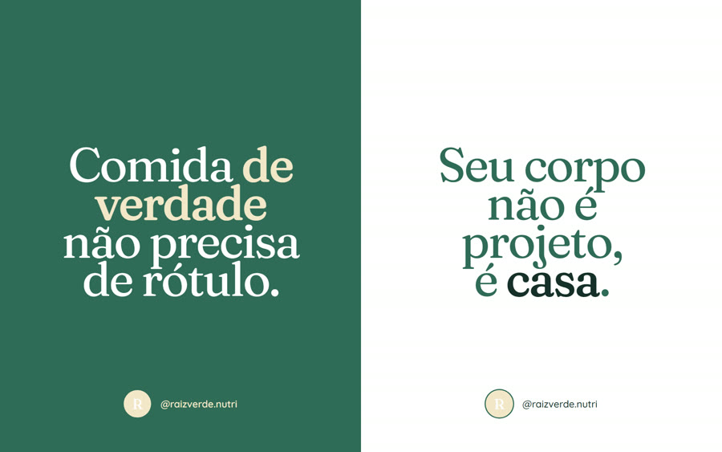
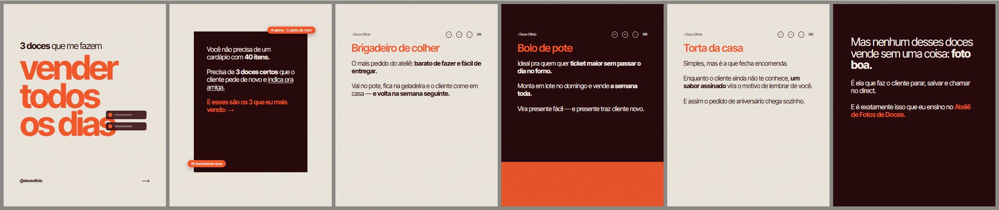
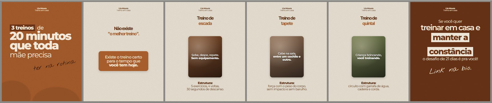
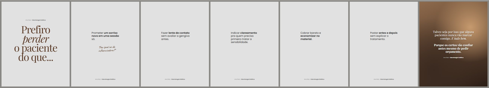
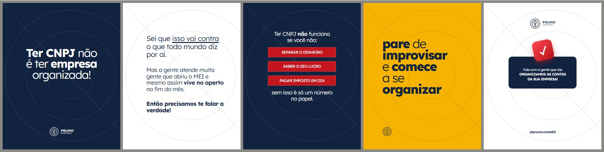
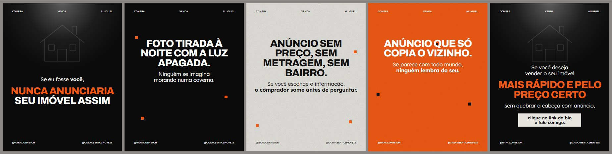
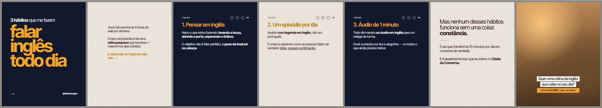

# Conteúdo Instagram — skill para Claude Code

**Um sistema completo de conteúdo para Instagram, para qualquer nicho e qualquer perfil.** Você junta os carrosséis que mais engajam no seu nicho e as referências visuais que você gosta; a skill transforma isso numa base de conhecimento do nicho e na identidade visual da sua marca, e passa a produzir **carrosséis de conteúdo, carrosséis de produto e posts estáticos** prontos para postar — com prévia por link, aprovação, exportação em PNG 1080×1350 com legenda e, se você quiser, agendamento.



> Exemplo com uma marca fictícia ("Raiz Verde", nutrição). Cores, fontes, @ e avatar vêm de um único arquivo de configuração — a mesma skill produz para uma loja de moda, uma clínica, um infoproduto ou um sex shop.

---

## Sumário

- [O que a skill faz](#o-que-a-skill-faz)
- [Como funciona (visão geral)](#como-funciona-visão-geral)
- [A pasta "Conteudo Instagram"](#a-pasta-conteudo-instagram)
- [Instalação](#instalação)
- [Primeiros passos](#primeiros-passos)
- [As fases em detalhe](#as-fases-em-detalhe)
- [Os três modelos de design](#os-três-modelos-de-design)
- [Configuração da marca (`marca.json`)](#configuração-da-marca-marcajson)
- [Scripts](#scripts)
- [Agendamento (opcional)](#agendamento-opcional)
- [Regras e cuidados embutidos](#regras-e-cuidados-embutidos)
- [Requisitos e limitações](#requisitos-e-limitações)
- [Origem](#origem)
- [Licença](#licença)

---

## O que a skill faz

| Etapa | O que você entrega | O que a skill produz |
|---|---|---|
| **Estrutura** | só pede para começar | a pasta `Conteudo Instagram` com 6 subpastas e instruções em cada uma |
| **Base de conhecimento** | 50 a 100 carrosséis dos concorrentes (imagens) | transcrição de todos os slides (OCR) e a `BASE-CONHECIMENTO.md` do nicho: público, personas, dores com frases reais, pilares, **ganchos** que funcionam, **frameworks** de narrativa, CTAs, tom, padrões visuais, regras e um banco de 30 ganchos prontos |
| **Branding e design** | referências visuais + foto do perfil | cores medidas nas referências, fontes encontradas por comparação, `marca.json` preenchido e `DESIGN.md` |
| **Palavras-chave** (opcional) | exportação do Google Search Console | mapa de palavras-chave limpo (sem buscas de loja, erros de digitação ou termos vulgares), para os posts também aparecerem no Google |
| **Carrossel de conteúdo** | um tema (ou nada — ela sugere) | ficha com 3 opções de capa, texto de cada slide, legenda com palavra-chave, texto alternativo, e a prévia visual por link |
| **Carrossel de produto** | o nome do produto (lê a exportação da Shopify) | carrossel com dados reais do produto, fotos da loja **recortadas por IA** e o produto atravessando os slides (efeito panorama) |
| **Post estático** | frases (suas ou de um banco) | posts de frase no padrão visual da marca, com legenda e crédito ao autor |
| **Exportação** | a sua aprovação | PNGs 1080×1350 + `legenda.txt`, organizados em `6 - Conteudo Aprovado` |
| **Agendamento** (opcional) | datas e horários | posts agendados no Instagram pelo SpartaGram |

---

## Como funciona (visão geral)



A ordem de prioridade que a skill segue em toda peça:

1. **Base de conhecimento do nicho** — o que funciona com *este* público (vem dos concorrentes).
2. **Diretriz de branding** — cores, fontes, tom e regras da *sua* marca.
3. **Palavras-chave** — quais palavras escrever para também aparecer no Google.
4. **Biblioteca universal** — ganchos, frameworks e regras de escrita que valem para qualquer nicho.

Nada é exportado nem agendado sem a sua aprovação.

---

## A pasta "Conteudo Instagram"

```
Conteudo Instagram/
├── 1 - Referencia de Designer/      ← você: modelos visuais que quer seguir
│   ├── Carrossel conteudo/
│   ├── Carrossel produto/
│   └── Post estatico/
├── 2 - Referencia de Concorrente/   ← você: 50–100 carrosséis do nicho (uma pasta por post)
├── 3 - Base de Conhecimento/        ← skill: TRANSCRICOES.md, BASE-CONHECIMENTO.md, DESIGN.md
│                                       (opcional: palavras-chave.csv, produtos.csv, banco-frases.json)
├── 4 - Diretriz de Branding/        ← você + skill: marca.json, avatar.png
├── 5 - Conteudo Pre Aprovado/       ← skill: ficha .md + roteiro .spec.json + prévia .html
└── 6 - Conteudo Aprovado/           ← skill, só depois da aprovação
    ├── 01 - Headline do carrossel/  (01.png, 02.png… + legenda.txt)
    └── Estaticos/                   (E001 - frase.png + .txt)
```

Cada pasta vem com um `LEIA-ME.md` explicando o que colocar nela.

---

## Instalação

**Requisitos:** [Claude Code](https://claude.com/claude-code) e [Node.js](https://nodejs.org) 18 ou superior.

```bash
# 1. Baixe o repositório
git clone https://github.com/SpartaMidiaDF/conteudo-instagram-skill.git

# 2. Copie a skill para a pasta de skills do Claude Code
#    macOS / Linux:
cp -r conteudo-instagram-skill/skill ~/.claude/skills/conteudo-instagram
#    Windows (PowerShell):
#    Copy-Item -Recurse conteudo-instagram-skill\skill $HOME\.claude\skills\conteudo-instagram

# 3. Instale as dependências dos scripts (Playwright + IA de recorte de fundo)
cd ~/.claude/skills/conteudo-instagram/scripts
npm install
npx playwright install chromium
```

Abra uma nova sessão do Claude Code. A skill aparece como `/conteudo-instagram` e também é acionada quando você pede coisas como "cria um carrossel", "analisa meus concorrentes" ou "faz um post de frase".

---

## Primeiros passos

1. **Crie a estrutura** — no Claude Code, na pasta onde quer guardar o conteúdo:
   > "Monta a estrutura de conteúdo do Instagram para a minha marca."

2. **Abasteça as pastas**
   - `2 - Referencia de Concorrente`: 50 a 100 carrosséis do seu nicho (uma subpasta por post, imagens em ordem).
   - `1 - Referencia de Designer`: prints de carrosséis e posts com o visual que você quer.
   - `4 - Diretriz de Branding`: `avatar.png` (a foto do perfil) e, se tiver, logo e paleta.

3. **Gere a base e a identidade**
   > "Analisa os concorrentes e cria a base de conhecimento."
   > "Monta o branding a partir das referências de design."

4. **Produza**
   > "Me traz 4 ideias de carrossel seguindo a base."
   > "Cria um carrossel do produto X." · "Faz 8 posts de frase."

5. **Aprove, exporte e (se quiser) agende**
   > "Aprovado, exporta." · "Agenda toda quarta às 12h a partir do dia 2."

---

## As fases em detalhe

### 1. Base de conhecimento do nicho
- **Transcrição:** no Windows, OCR nativo do sistema (sem instalar nada) para todas as imagens; em macOS/Linux, `tesseract` ou leitura das imagens pelo próprio Claude.
- **Leitura visual:** a skill monta folhas de contato das capas para entender o design dos concorrentes (o OCR não vê design).
- **Análise:** a `BASE-CONHECIMENTO.md` segue um modelo de 15 seções (`skill/guia/MODELO-BASE.md`) — perfis analisados, público, personas, dores e frases reais, pilares, ganchos, frameworks, CTAs, linguagem, visual, adaptação para a marca, regras, banco de ganchos, checklist e índice de todos os posts analisados.

### 2. Branding e design
- **Cores** medidas diretamente nas suas referências (pixel a pixel).
- **Fontes** descobertas por comparação: a skill renderiza a mesma frase em várias fontes do Google e compara com a referência (`comparar-fontes.js`).
- Resultado em `marca.json` (lido por todos os geradores) e `DESIGN.md`.

### 3. Carrossel de conteúdo
Briefing (tema, persona, objetivo, framework), palavra-chave com a mesma intenção do post, **3 opções de capa** com ganchos diferentes, slides seguindo o framework escolhido, ficha completa (legenda, texto alternativo, observações), prévia renderizada e conferida antes de você ver.

### 4. Carrossel de produto
Lê os dados reais da exportação de produtos da Shopify (só usa características que estão na descrição), baixa as fotos da loja, **remove o fundo com IA local** (sem internet, sem custo) e monta o carrossel panorama: problema → produto entrando → "Conheça o X" com etiquetas → benefícios → produto centralizado na divisa → "Primeira vez? 3 passos" → CTA.

### 5. Post estático de frase
Frases suas, da base ou de um banco de frases; 1–2 palavras de destaque; fundo na cor da marca ou claro; a frase se ajusta sozinha ao espaço; legenda com crédito ao autor.

### 6. Exportação e agendamento
PNGs 1080×1350 numerados e `legenda.txt` em `6 - Conteudo Aprovado`. Agendamento opcional (veja abaixo).

---

## Os três modelos de design

| Modelo | Para quê | Como é |
|---|---|---|
| **Editorial** (`gerar-conteudo.js`) | carrossel de conteúdo | papel claro × fundo escuro, título serifado com destaque em itálico, anotação manuscrita com seta, slides em moldura de "app de notas", numeração 001/010 |
| **Panorama** (`gerar-produto.js`) | carrossel de produto | fundo escuro, um slide claro de respiro, título pesado + texto itálico, etiquetas, foto recortada atravessando a divisa entre slides (vira um panorama ao deslizar), botão "Comente PALAVRA" |
| **Estático** (`gerar-estatico.js`) | post de frase | fundo sólido (cor da marca ou claro), frase grande centralizada, destaque na cor escura, avatar + @ no rodapé |



Todos os modelos leem cores, fontes, @, avatar e censura do `marca.json`. Se as suas referências pedirem outro layout, a skill adapta o CSS do gerador e registra a decisão no `DESIGN.md`.

### Galeria: estilos adaptados de referências

Na Fase 2, a skill não fica presa aos três modelos: ela lê as referências de design que você colocou em `1 - Referencia de Designer` e adapta o layout à sua marca. Abaixo, seis carrosséis de **marcas fictícias** em nichos diferentes, cada um seguindo um modelo de referência (o código de todos está em [`exemplos/estilos/estilos.html`](exemplos/estilos/estilos.html), para servir de ponto de partida).

**1. Notas em papel** — confeitaria: papel creme × vinho, título gigante em laranja, slides em moldura de app de notas.


**2. Caramelo com cartões** — personal trainer: tons de caramelo, etiquetas sobre o título, cartão com foto e "Estrutura:" embaixo, assinatura manuscrita.


**3. Minimalista com serifa** — odontologia: fundo cinza, uma ideia por slide, capa serifada com itálico e fechamento sobre foto.


**4. Corporativo azul e amarelo** — contabilidade: azul-marinho, branco e amarelo, marca d'água de círculos, botões vermelhos e card de contato.


**5. Impacto em caixa alta** — corretor de imóveis: preto, cinza e laranja, títulos pesados em caixa alta, barra de temas no topo e @ no rodapé.


**6. Esteira escura** — escola de inglês: começa no escuro, alterna com papel claro, notas numeradas e CTA "Comenta PALAVRA".


Nos slides que pedem foto, os exemplos usam um degradê no lugar da imagem. No uso real, entram as fotos da marca.

Exemplos prontos dos arquivos de entrada em [`exemplos/`](exemplos/): `marca.json`, `carrossel-conteudo.spec.json`, `carrossel-produto.spec.json` e `estaticos.json`.

---

## Configuração da marca (`marca.json`)

```json
{
  "nome": "Raiz Verde",
  "arroba": "raizverde.nutri",
  "assinatura": "RAIZ VERDE",
  "nicho": "nutrição",
  "avatar": "avatar.png",
  "cores": {
    "claro": "#f3f1ea", "escuro": "#16302a", "acento": "#e0703a", "acento_claro": "#f08a55",
    "texto_escuro": "#16302a", "texto_claro": "#eef2ec",
    "estatico_fundo": "#2f6b57", "estatico_destaque": "#f3e7c9"
  },
  "fontes": {
    "titulo": "Fraunces", "texto": "Inter", "manuscrita": "Caveat",
    "produto_titulo": "Inter", "detalhe": "Quicksand", "estatico": "Fraunces"
  },
  "google_fonts": ["Fraunces:ital,wght@0,400;0,700;1,400", "Inter:wght@400;500;600;700;800", "Caveat:wght@500;700", "Quicksand:wght@400;500;600"],
  "tom": "amiga que entende do assunto, acolhedora, humor leve",
  "palavras_da_marca": [],
  "palavras_proibidas": [],
  "censura": [["dieta", "di.eta"]],
  "regras": ["Nunca inventar estatística, depoimento ou nome", "Sem promessa de resultado de saúde"]
}
```

| Campo | Para que serve |
|---|---|
| `nome`, `arroba`, `assinatura`, `inicial` | aparecem nos slides (topo, rodapé, logo); `inicial` é usada quando não há `avatar.png` |
| `cores` | toda a paleta dos três modelos |
| `fontes` + `google_fonts` | famílias e pesos carregados do Google Fonts |
| `censura` | palavras sensíveis do nicho que saem "quebradas" nas imagens (ex.: nichos de saúde íntima, finanças com termos sensíveis) — a legenda continua por extenso para a busca |
| `tom`, `palavras_da_marca`, `palavras_proibidas`, `regras` | lidos pela skill na hora de escrever |

---

## Scripts

Todos em `skill/scripts/`, rodam de qualquer pasta dentro do projeto (ou com a variável `CONTEUDO_IG` apontando para a pasta `Conteudo Instagram`).

| Script | O que faz |
|---|---|
| `iniciar.js [pasta]` | cria a estrutura `Conteudo Instagram` com LEIA-MEs e `marca.json` modelo |
| `ocr.ps1 -Root … -Saida … [-Idioma pt-BR]` | (Windows) transcreve todos os carrosséis dos concorrentes |
| `comparar-fontes.js "<frase>" saida.png "Fonte A" "Fonte B" …` | renderiza a frase em várias fontes para comparar com a referência |
| `gerar-conteudo.js <spec.json>` | gera a prévia do carrossel de conteúdo (modelo editorial) |
| `gerar-produto.js <spec.json>` | gera a prévia do carrossel de produto (modelo panorama) |
| `gerar-estatico.js <lote.json>` | gera a prévia dos posts estáticos |
| `produto.js "<nome>" [--fotos pasta]` | lê produto da exportação da Shopify e baixa as fotos |
| `recorte.js <foto> <saida.png> [ia\|limite]` | remove o fundo da foto do produto (IA local por padrão) e apara |
| `exportar.js <html> "<headline>"` | exporta o carrossel aprovado (PNGs + legenda.txt) |
| `exportar-estatico.js <html>` | exporta os estáticos aprovados (PNG + .txt) |
| `agendar.js "<post>" "AAAA-MM-DD HH:MM" …` | agenda no Instagram pelo SpartaGram (opcional) |

O formato de cada `spec.json` está documentado no topo do script correspondente.

---

## Agendamento (opcional)

A skill agenda posts usando o [SpartaGram](https://social.spartamidia.com) via MCP. Instale o conector com o seu token:

```bash
claude mcp add --transport http --scope user spartagram https://social.spartamidia.com/mcp --header "Authorization: Bearer SEU_TOKEN"
```

Depois é só pedir: *"Agenda os carrosséis 09 a 12 toda quarta às 12h a partir de 02/12."* A skill confere os agendamentos pendentes, sobe as imagens na ordem e agenda com a legenda. Sem o conector, todo o resto funciona normalmente — você posta os PNGs manualmente.

---

## Regras e cuidados embutidos

- **Nada sem aprovação:** prévia por link → você aprova → só então exporta ou agenda.
- **Nada inventado:** nenhuma estatística sem fonte, nenhum depoimento ou nome fictício, nenhum link inventado.
- **Autoridade honesta:** a marca só fala como especialista se for; senão, a autoridade vem de fonte citada ou de especialista parceiro identificado.
- **Sem texto com cara de IA:** lista de frases proibidas ("No mundo de hoje", "Vamos mergulhar"…), ritmo com frases curtas e reescrita da capa e do último slide.
- **Direitos autorais:** letras de música ficam fora dos bancos de frases; frases de terceiros sempre com crédito.
- **Produto sem promessa:** só características reais da descrição; alegações de saúde e promessas de resultado são cortadas.

---

## Requisitos e limitações

- **Node.js 18+** e Chromium do Playwright (instalado no passo 3).
- **OCR:** o script incluso usa o OCR nativo do **Windows** (precisa do pacote de idioma instalado). Em macOS/Linux, use `tesseract` ou deixe o Claude ler as imagens (mais lento para 100 posts).
- **IA de recorte:** `@imgly/background-removal-node` (cerca de 130 MB, roda local). Licença AGPL — tranquilo para uso interno na produção de imagens; avalie se for redistribuir o software.
- **Produtos:** o leitor entende a exportação de produtos da **Shopify**. Para outras plataformas, informe os dados do produto direto na conversa.
- **Concorrentes:** a skill não baixa posts do Instagram — você coloca as imagens na pasta (há ferramentas de download de carrossel que salvam no formato esperado).

---

## Origem

A skill nasceu de um projeto real: a análise de **122 carrosséis de 4 perfis de especialistas** de um nicho, que virou uma base de conhecimento, um mapa de palavras-chave do Search Console, dezenas de carrosséis e posts aprovados e agendados. Este repositório é a versão genérica desse processo — o método é o mesmo, só muda o nicho.

## Licença

[MIT](LICENSE) — use, adapte e distribua à vontade. As dependências têm licenças próprias (Playwright: Apache-2.0; `@imgly/background-removal-node`: AGPL-3.0).
